# 02 · Screens

All 45 app screens plus 6 notification and widget boards (4 phone mockups, 2 system sheets), grouped by journey. Each screen has:

- **Image:** `design/screens/<id>.png`. Rendered at 2× from the 390×844 design frame. This is the visual truth.
- **Source:** `design/html/<id>.dc.html`. Exact inline styles, sizes and colours. Read it when the PNG is ambiguous.
- **Copy:** every string on the screen, in order. Use it verbatim (it has been through tone review).
- **Goes to:** the screens it links to (navigation targets).
- **Motion:** the screen-specific animation. The shared system is in `04-MOTION.md`.

Data on these screens comes from `seed/fixtures/personas.ts`. Manish (32) is the main persona and Sunita (64) is the retiree.

## Known design fixes (apply while building)

1. **2.1 Home:** the ring label "education" should read "Education".
2. **4.2 Payday and 9.2 Expanded notification:** "Show me what to buy" breaks the rule that the app never says buy or sell. Use **"Show me the moves"**.
3. **10.1 Levels:** "Level 3 · Secure" wraps awkwardly next to Gullu. Put "Level 3" on one line and "Secure" on the next. The Builder row's "11 of 12 paydays" wraps; give the progress line the full row width.
4. **10.1 Levels** shows the Home tab as active. Levels is pushed from Home, so keep the tab bar but mark no tab active, or hide the tab bar on pushed screens (pick one rule app-wide).
5. **3.1 Goals** rows are four lines tall. Check them on small phones (375pt wide); truncate the range text before the amount.
6. The 1.x onboarding step dots show 5 steps but there are 6 input screens (1.2–1.6 plus goals). Make the count match.

## 1 · Onboarding

### 1.1 Welcome

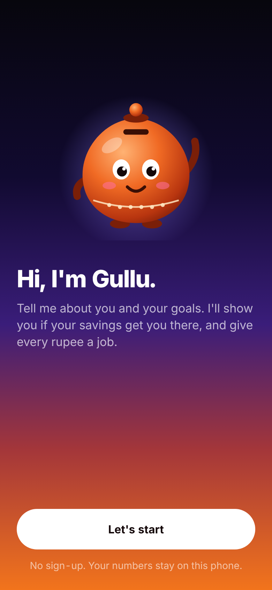

- **Id:** `V-1-1-Welcome` · **Background:** `dusk`
- **Purpose:** First impression. Sets the promise: offline, no sign-up, every rupee gets a job.
- **Goes to:** 1.2 About You
- **Motion:** Gullu drops in from above the fold with a squash-and-stretch landing (spring), then waves twice. Headline and body rise 12px and fade in, staggered 60ms. The 'Let's start' button slides up last. Ambient: the dusk gradient drifts slowly (8s loop, 3% hue shift).

**Copy:**

```text
Hi, I'm Gullu.
Tell me about you and your goals. I'll show you if your savings get you there, and give every rupee a job.
Let's start
No sign-up. Your numbers stay on this phone.
```

### 1.2 About You

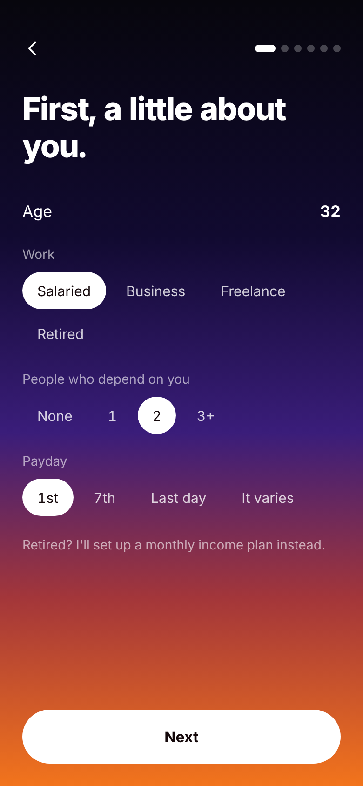

- **Id:** `V-1-2-AboutYou` · **Background:** `dusk`
- **Purpose:** Who are we planning for: age, work type, dependents, payday. Picks the life stage.
- **Goes to:** 1.1 Welcome, 1.3 Risk Check
- **Motion:** Step dots morph (the active dot widens from 8 to 22px). Age is a wheel with haptic ticks. Pills animate their fill with a shared 'selected' background that slides between options (layout animation). Choosing Retired cross-fades the helper line and changes the step count.

**Copy:**

```text
First, a little about you.
Age 32
Work
Salaried Business Freelance Retired
People who depend on you
None 1 2 3+
Payday
1st 7th Last day It varies
Retired? I'll set up a monthly income plan instead.
Next
```

### 1.3 Risk Check

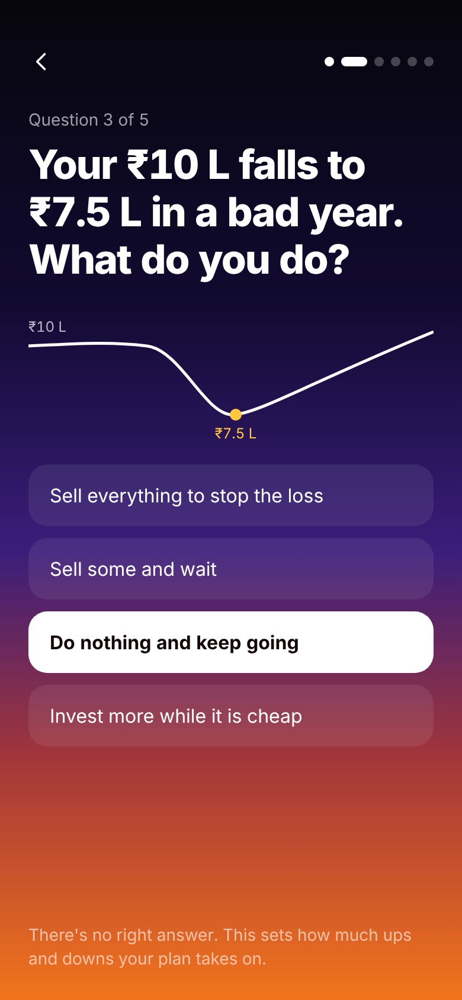

- **Id:** `V-1-3-RiskCheck` · **Background:** `dusk`
- **Purpose:** Risk tolerance via scenario questions. Capacity and tolerance are scored separately; the lower wins.
- **Goes to:** 1.2 About You, 1.4 Goals
- **Motion:** The ₹10 L → ₹7.5 L number counts down while a small bar chart drops, so the fall is felt, not read. Answer cards press in (scale 0.97) and the chosen one gets a glow. Questions slide horizontally; progress text cross-fades.

**Copy:**

```text
Question 3 of 5
Your ₹10 L falls to ₹7.5 L in a bad year. What do you do?
Sell everything to stop the loss Sell some and wait Do nothing and keep going Invest more while it is cheap
There's no right answer. This sets how much ups and downs your plan takes on.
```

### 1.4 Goals

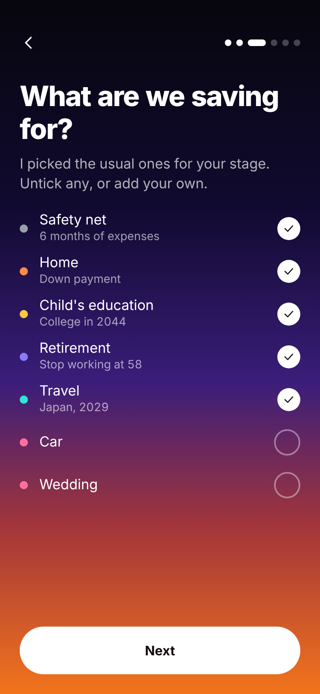

- **Id:** `V-1-4-Goals` · **Background:** `dusk`
- **Purpose:** Goal templates pre-ticked for the life stage. Untick, add, or edit.
- **Goes to:** 1.3 Risk Check, 1.5 What You Have, 3.3 Edit Goal
- **Motion:** Goal rows enter with a 40ms stagger. Ticking draws the checkmark path (stroke animation) with a light haptic. Unticked rows dim to 50% opacity. Gullu peeks from the corner and nods when a goal is added.

**Copy:**

```text
What are we saving for?
I picked the usual ones for your stage. Untick any, or add your own.
Safety net 6 months of expenses Home Down payment Child's education College in 2044 Retirement Stop working at 58 Travel Japan, 2029 Car Wedding
Next
```

### 1.5 What You Have

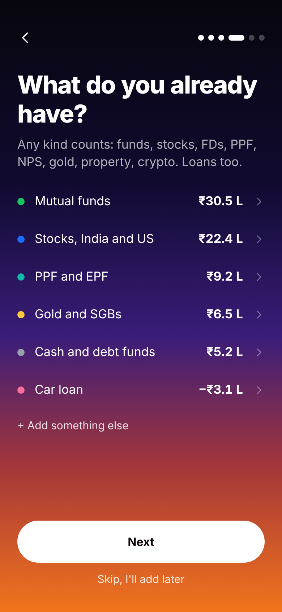

- **Id:** `V-1-5-WhatYouHave` · **Background:** `dusk`
- **Purpose:** What you already have, any asset type, plus loans. Can skip.
- **Goes to:** 1.4 Goals, 1.6 Monthly, 5.3 Holdings
- **Motion:** Each class row has a mini bar that grows to its value on enter. Adding a holding drops a coin into Gullu (small coin arc animation). The loan row shows its amount in negative, sliding in from the right.

**Copy:**

```text
What do you already have?
Any kind counts: funds, stocks, FDs, PPF, NPS, gold, property, crypto. Loans too.
Mutual funds ₹30.5 L Stocks, India and US ₹22.4 L PPF and EPF ₹9.2 L Gold and SGBs ₹6.5 L Cash and debt funds ₹5.2 L Car loan −₹3.1 L
+ Add something else
Next
Skip, I'll add later
```

### 1.6 Monthly

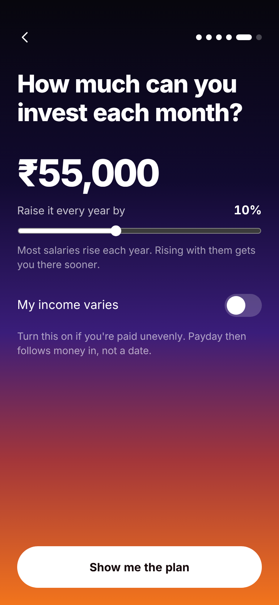

- **Id:** `V-1-6-Monthly` · **Background:** `dusk`
- **Purpose:** Monthly investable amount, yearly raise, variable-income toggle.
- **Goes to:** 1.5 What You Have, 1.7 Answer
- **Motion:** The amount is a draggable dial. Digits roll like an odometer while dragging, with haptic ticks every ₹1,000. Toggling 'My income varies' morphs the payday copy.

**Copy:**

```text
How much can you invest each month?
₹55,000
Raise it every year by 10%
Most salaries rise each year. Rising with them gets you there sooner.
My income varies
Turn this on if you're paid unevenly. Payday then follows money in, not a date.
Show me the plan
```

### 1.7 Answer

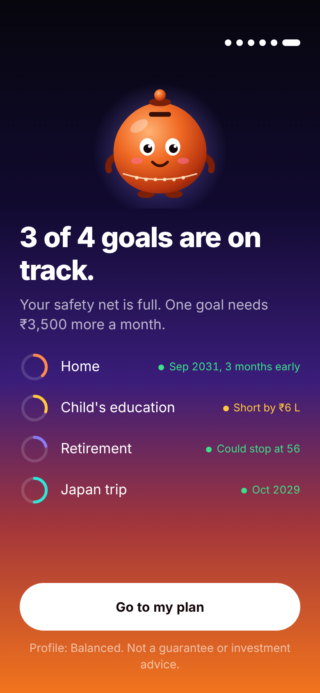

- **Id:** `V-1-7-Answer` · **Background:** `dusk`
- **Purpose:** The answer. 3 of 4 goals on track, one fix per off-track goal.
- **Goes to:** 2.1 Home
- **Motion:** The reveal moment: a 600ms build. Gullu celebrates (coins burst), the headline counts '0 → 3 of 4', and goal rows cascade in with their status colour sweeping across. The off-track goal pulses once in amber. Disclaimer fades in last.

**Copy:**

```text
3 of 4 goals are on track.
Your safety net is full. One goal needs ₹3,500 more a month.
Home Sep 2031, 3 months early
Child's education Short by ₹6 L
Retirement Could stop at 56
Japan trip Oct 2029
Go to my plan
Profile: Balanced. Not a guarantee or investment advice.
```

## 2 · Home

### 2.1 Home

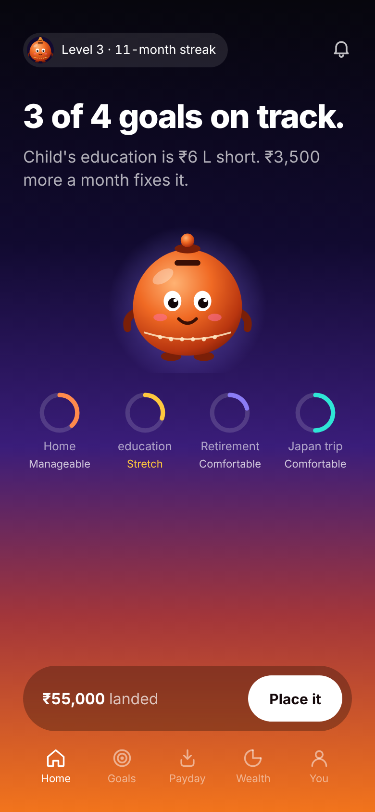

- **Id:** `V-2-1-Home` · **Background:** `dusk`
- **Purpose:** Home: one headline across all goals, goal rings, payday bar. Level and streak chip top-left.
- **Goes to:** 10.1 Levels, 3.1 Goals, 3.2 Goal Detail, 4.1 Nudge, 4.2 Payday, 5.1 Net Worth, 8.1 Profile Risk
- **Motion:** Rings fill from 0 to their value on first paint (spring, staggered 80ms). Gullu breathes (scale 1 → 1.02, 3s loop) and blinks every 4–6s at random. When payday has landed, the bar glows and Gullu's eyes track it. Pull down: Gullu stretches like a rubber band and the plan recomputes. Tapping a ring zooms it into Goal detail (shared element).

**Copy:**

```text
Level 3 · 11-month streak
3 of 4 goals on track.
Child's education is ₹6 L short. ₹3,500 more a month fixes it.
Home Manageable education Stretch Retirement Comfortable Japan trip Comfortable
₹55,000 landed
Place it
Home Goals Payday Wealth You
```

### 2.2 Market Fall

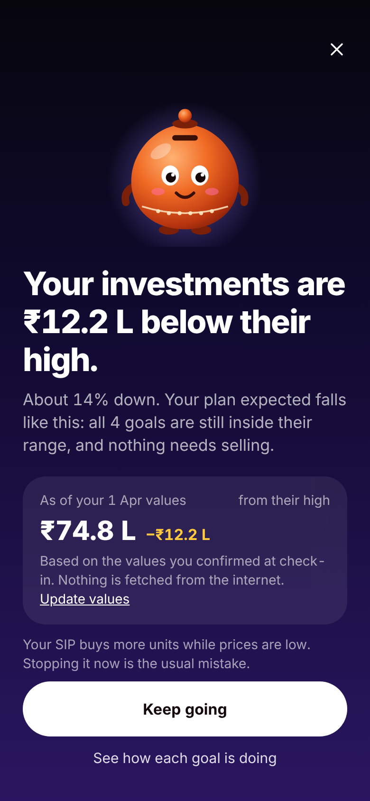

- **Id:** `V-2-2-MarketFall` · **Background:** `dim`
- **Purpose:** Market-fall moment, from the user's own value updates. Calm, no selling.
- **Goes to:** 2.1 Home, 3.1 Goals, 5.3 Holdings
- **Motion:** No alarm motion. Gullu is calm, not shaking. The fall line draws slowly (1.2s ease-out) and the range band fades in behind it, so the fall visibly lands inside the expected range. 'Keep going' has a soft breathing glow.

**Copy:**

```text
Your investments are ₹12.2 L below their high.
About 14% down. Your plan expected falls like this: all 4 goals are still inside their range, and nothing needs selling.
As of your 1 Apr values from their high
₹74.8 L −₹12.2 L
Based on the values you confirmed at check-in. Nothing is fetched from the internet. Update values
Your SIP buys more units while prices are low. Stopping it now is the usual mistake.
Keep going
See how each goal is doing
```

### 2.3 Milestone

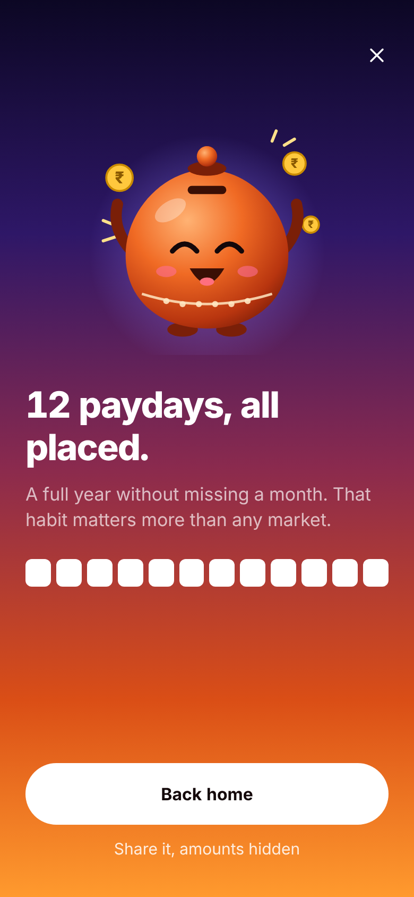

- **Id:** `V-2-3-Milestone` · **Background:** `ember`
- **Purpose:** Milestone celebration for habits (12 paydays), never for market luck.
- **Goes to:** 2.1 Home
- **Motion:** Confetti made of tiny coins and marigold petals in Skia (about 40 particles, gravity, 1.6s). Gullu celebrates. The '12' counts up. Success haptic. Respect reduced motion (static badge instead).

**Copy:**

```text
12 paydays, all placed.
A full year without missing a month. That habit matters more than any market.
Back home
Share it, amounts hidden
```

## 3 · Goals

### 3.1 Goals

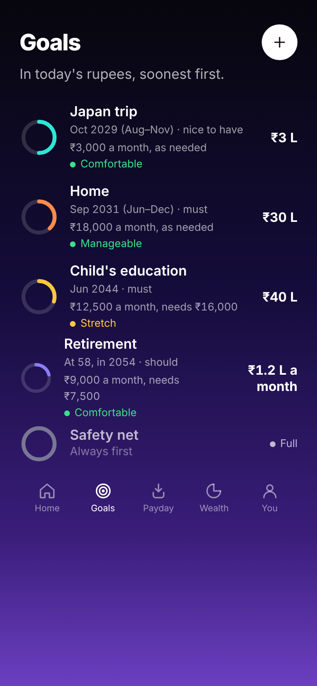

- **Id:** `V-3-1-Goals` · **Background:** `violet`
- **Purpose:** All goals by date: affordability word, required vs actual, date ranges, priority.
- **Goes to:** 2.1 Home, 3.2 Goal Detail, 3.3 Edit Goal, 4.2 Payday, 5.1 Net Worth, 8.1 Profile Risk
- **Motion:** The list staggers in. The affordability dot pulses once on Stretch rows. Required-vs-actual shows as a thin dual bar that fills to actual, with a ghost marker at required. Long-press to reorder (lift with shadow and haptic).

**Copy:**

```text
Goals
In today's rupees, soonest first.
Japan trip Oct 2029 (Aug–Nov) · nice to have ₹3,000 a month, as needed Comfortable ₹3 L Home Sep 2031 (Jun–Dec) · must ₹18,000 a month, as needed Manageable ₹30 L Child's education Jun 2044 · must ₹12,500 a month, needs ₹16,000 Stretch ₹40 L Retirement At 58, in 2054 · should ₹9,000 a month, needs ₹7,500 Comfortable ₹1.2 L a month
Safety net Always first Full
Home Goals Payday Wealth You
```

### 3.2 Goal Detail

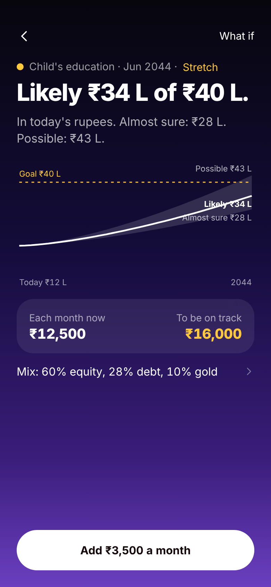

- **Id:** `V-3-2-GoalDetail` · **Background:** `violet`
- **Purpose:** Will this goal happen: range band, monthly now vs needed, mix.
- **Goes to:** 3.1 Goals, 3.4 Glide Path, 6.1 What If, 6.2 Apply
- **Motion:** The fan chart draws left to right, then the three bands (almost sure, likely, possible) settle in from the centre line. Scrubbing the chart moves a lens with a value label (haptic on year boundaries). 'Add ₹3,500 a month' previews: the band lifts live before you commit.

**Copy:**

```text
What if
Child's education · Jun 2044 · Stretch
Likely ₹34 L of ₹40 L.
In today's rupees. Almost sure: ₹28 L. Possible: ₹43 L.
Each month now ₹12,500 To be on track ₹16,000
Mix: 60% equity, 28% debt, 10% gold
Add ₹3,500 a month
```

### 3.3 Edit Goal

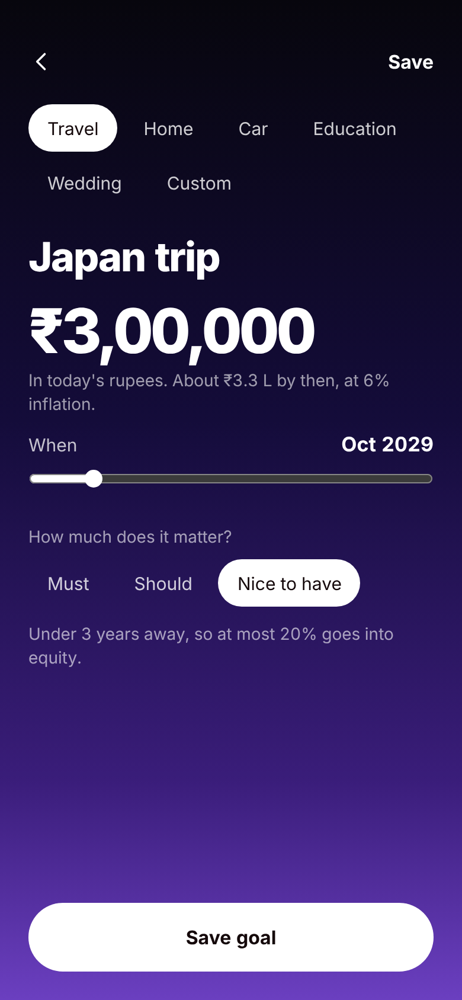

- **Id:** `V-3-3-EditGoal` · **Background:** `violet`
- **Purpose:** Add or edit a goal: template, amount in today's rupees, date, priority.
- **Goes to:** 3.1 Goals
- **Motion:** Template chips scroll with snap. Changing the date animates the 'at most 20% equity' note when the horizon crosses a cap band. Amount digits roll.

**Copy:**

```text
Save
Travel Home Car Education Wedding Custom
Japan trip
₹3,00,000
In today's rupees. About ₹3.3 L by then, at 6% inflation.
When Oct 2029
How much does it matter?
Must Should Nice to have
Under 3 years away, so at most 20% goes into equity.
Save goal
```

### 3.4 Glide Path

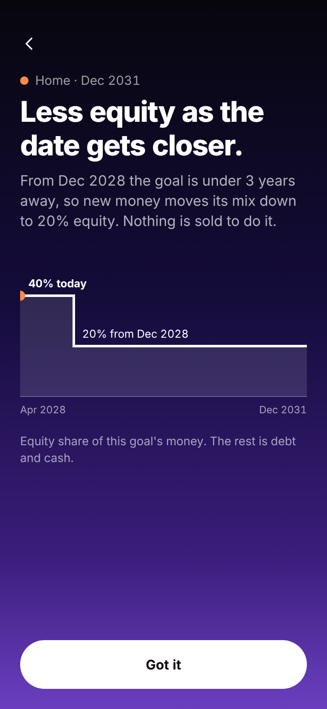

- **Id:** `V-3-4-GlidePath` · **Background:** `violet`
- **Purpose:** Glide path explainer: equity share falls as the date nears.
- **Goes to:** 3.2 Goal Detail
- **Motion:** Step chart draws year by year; the 'today' marker drops in with a bounce. Each cap step (60 → 40 → 20%) highlights in sequence with its caption.

**Copy:**

```text
Home · Dec 2031
Less equity as the date gets closer.
From Dec 2028 the goal is under 3 years away, so new money moves its mix down to 20% equity. Nothing is sold to do it.
Equity share of this goal's money. The rest is debt and cash.
Got it
```

### 3.5 Goal Day

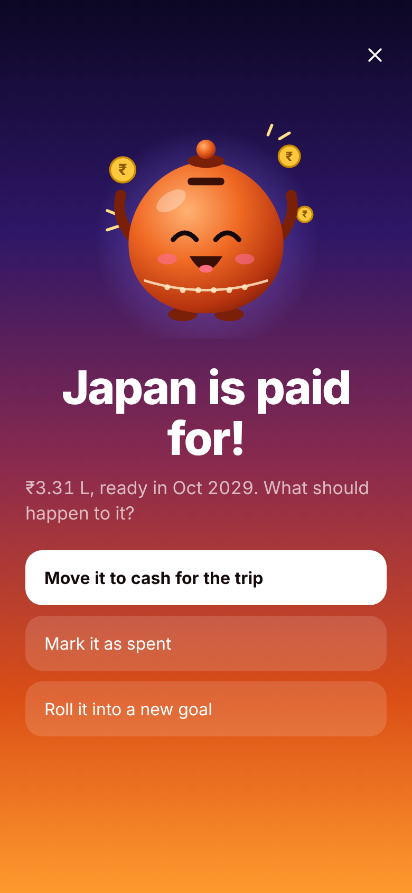

- **Id:** `V-3-5-GoalDay` · **Background:** `ember`
- **Purpose:** Goal day: the goal is reached. Spend, move to cash, or roll over.
- **Goes to:** 3.1 Goals, 3.3 Edit Goal
- **Motion:** A big moment: Gullu celebrates, the goal ring completes its final arc and bursts into coins. The three options rise in after 400ms.

**Copy:**

```text
Japan is paid for!
₹3.31 L, ready in Oct 2029. What should happen to it?
Move it to cash for the trip
Mark it as spent
Roll it into a new goal
```

## 4 · Payday — the monthly loop

### 4.1 Nudge


- **Id:** `V-4-1-Nudge` · **Background:** `dusk`
- **Purpose:** Payday nudge (local notification, the user's chosen day).
- **Goes to:** 4.2 Payday
- **Motion:** System notification. In-app, the payday bar on Home animates in from the bottom with a coin drop.

**Copy:**

```text
Saturday, 1 April
9:41
Money Plan now Payday: ₹55,000 to place 4 goals and your PPF. Tap to see the split.
```

### 4.2 Payday

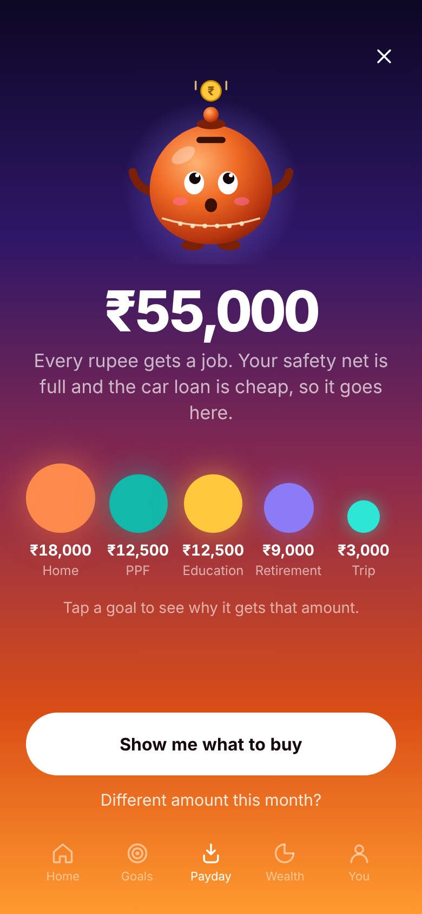

- **Id:** `V-4-2-Payday` · **Background:** `ember`
- **Purpose:** Payday: Gullu catches the amount, bubbles per goal sized by rupees.
- **Goes to:** 2.1 Home, 3.1 Goals, 4.3 Why This Amount, 4.4 Check In, 4.6 Short Month, 5.1 Net Worth, 8.1 Profile Risk
- **Motion:** Signature animation. A coin falls into Gullu's slot (catch pose, squash on impact, heavy haptic). The amount counts up. Bubbles burst out of Gullu and float to their positions on springs, sized by amount, with a gentle idle bob (each bubble on its own phase). Tap a bubble: it expands into Why this amount (shared element).

**Copy:**

```text
₹55,000
Every rupee gets a job. Your safety net is full and the car loan is cheap, so it goes here.
₹18,000 Home
₹12,500 PPF
₹12,500 Education
₹9,000 Retirement
₹3,000 Trip
Tap a goal to see why it gets that amount.
Show me what to buy
Different amount this month?
Home Goals Payday Wealth You
```

### 4.3 Why This Amount

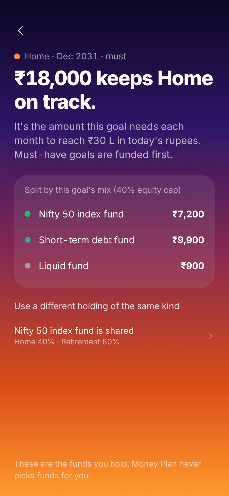

- **Id:** `V-4-3-WhyThisAmount` · **Background:** `ember`
- **Purpose:** Why this amount: the flow step, the goal's need, split by the goal's mix into the user's own holdings.
- **Goes to:** 4.2 Payday, 5.3 Holdings, 5.6 Holding split
- **Motion:** Opens from the tapped bubble (shared element). Split rows fill as horizontal bars in sequence. The shared-holding card has a split-ring that animates to 40/60.

**Copy:**

```text
Home · Dec 2031 · must
₹18,000 keeps Home on track.
It's the amount this goal needs each month to reach ₹30 L in today's rupees. Must-have goals are funded first.
Split by this goal's mix (40% equity cap)
Nifty 50 index fund ₹7,200
Short-term debt fund ₹9,900
Liquid fund ₹900
Use a different holding of the same kind
Nifty 50 index fund is shared Home 40% · Retirement 60%
These are the funds you hold. Money Plan never picks funds for you.
```

### 4.4 Check In

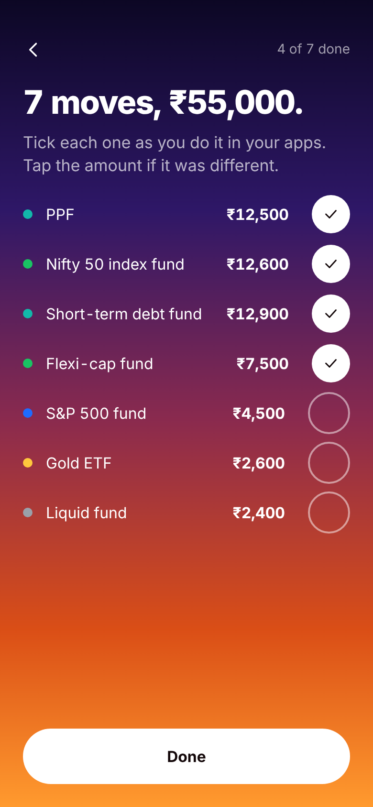

- **Id:** `V-4-4-CheckIn` · **Background:** `ember`
- **Purpose:** Check-in: tick each move as you do it in your apps; edit amounts.
- **Goes to:** 4.2 Payday, 4.5 Receipt
- **Motion:** Ticking a row: check path draws, row slides 4px and dims, the progress text '4 of 7' rolls, and the top progress ring advances. On the last tick, Gullu does a little hop and the Done button pulses.

**Copy:**

```text
4 of 7 done
7 moves, ₹55,000.
Tick each one as you do it in your apps. Tap the amount if it was different.
PPF ₹12,500
Nifty 50 index fund ₹12,600
Short-term debt fund ₹12,900
Flexi-cap fund ₹7,500
S&P 500 fund ₹4,500
Gold ETF ₹2,600
Liquid fund ₹2,400
Done
```

### 4.5 Receipt

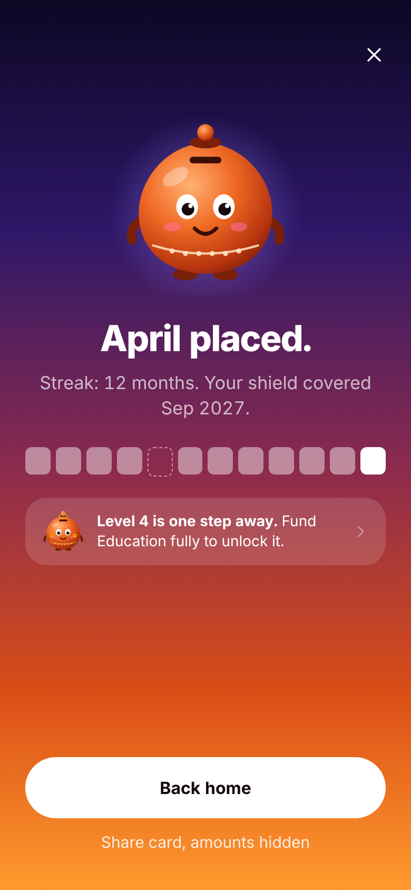

- **Id:** `V-4-5-Receipt` · **Background:** `ember`
- **Purpose:** Receipt: April placed, streak, shield, next level.
- **Goes to:** 10.1 Levels, 2.1 Home
- **Motion:** A paper-receipt reveal: the card slides down from a slot with a ratchet haptic per line. The streak flame or calendar row fills cell by cell. The 'Level 4 is one step away' card shimmers once.

**Copy:**

```text
April placed.
Streak: 12 months. Your shield covered Sep 2027.
Level 4 is one step away. Fund Education fully to unlock it.
Back home
Share card, amounts hidden
```

### 4.6 Short Month

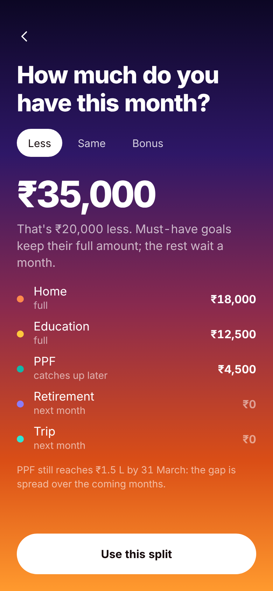

- **Id:** `V-4-6-ShortMonth` · **Background:** `ember`
- **Purpose:** Short or bonus month: enter the real amount; must-haves keep full amount.
- **Goes to:** 4.2 Payday, 4.4 Check In
- **Motion:** Segmented control slides. As the amount changes, each row's bar animates to its new value, and rows that drop to ₹0 fade to 'next month'.

**Copy:**

```text
How much do you have this month?
Less Same Bonus
₹35,000
That's ₹20,000 less. Must-have goals keep their full amount; the rest wait a month.
Home full ₹18,000
Education full ₹12,500
PPF catches up later ₹4,500
Retirement next month ₹0
Trip next month ₹0
PPF still reaches ₹1.5 L by 31 March: the gap is spread over the coming months.
Use this split
```

### 4.7 Flow Rules

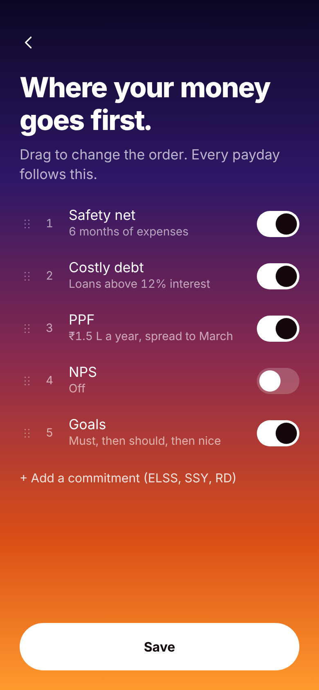

- **Id:** `V-4-7-FlowRules` · **Background:** `ember`
- **Purpose:** Flow rules: drag to reorder where money goes first; toggle commitments.
- **Goes to:** 4.2 Payday
- **Motion:** Drag to reorder with lift, shadow and haptics (sortable list). Numbers re-index with a rolling animation. Toggles use spring thumbs.

**Copy:**

```text
Where your money goes first.
Drag to change the order. Every payday follows this.
1 Safety net 6 months of expenses
2 Costly debt Loans above 12% interest
3 PPF ₹1.5 L a year, spread to March
4 NPS Off
5 Goals Must, then should, then nice
+ Add a commitment (ELSS, SSY, RD)
Save
```

## 5 · Wealth

### 5.1 Net Worth

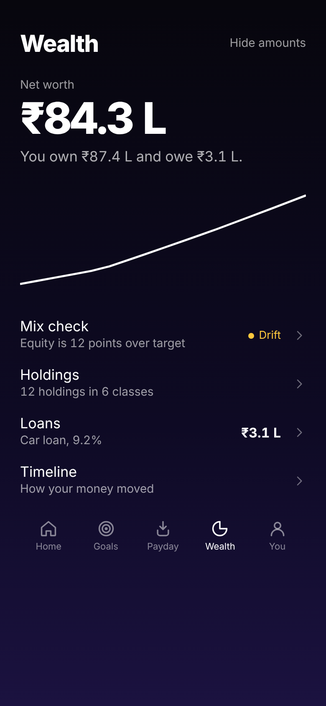

- **Id:** `V-5-1-NetWorth` · **Background:** `night`
- **Purpose:** Net worth: own minus owe, hide-amounts, entry to mix, holdings, loans, timeline.
- **Goes to:** 2.1 Home, 3.1 Goals, 4.2 Payday, 5.2 Mix Check, 5.3 Holdings, 5.4 Loans, 5.5 Timeline, 8.1 Profile Risk
- **Motion:** The net worth number counts up. Tapping 'Hide amounts' blurs every rupee figure (animated blur/redaction). The trend sparkline draws in.

**Copy:**

```text
Wealth Hide amounts
Net worth
₹84.3 L
You own ₹87.4 L and owe ₹3.1 L.
Mix check Equity is 12 points over target Drift
Holdings 12 holdings in 6 classes
Loans Car loan, 9.2% ₹3.1 L
Timeline How your money moved
Home Goals Payday Wealth You
```

### 5.2 Mix Check

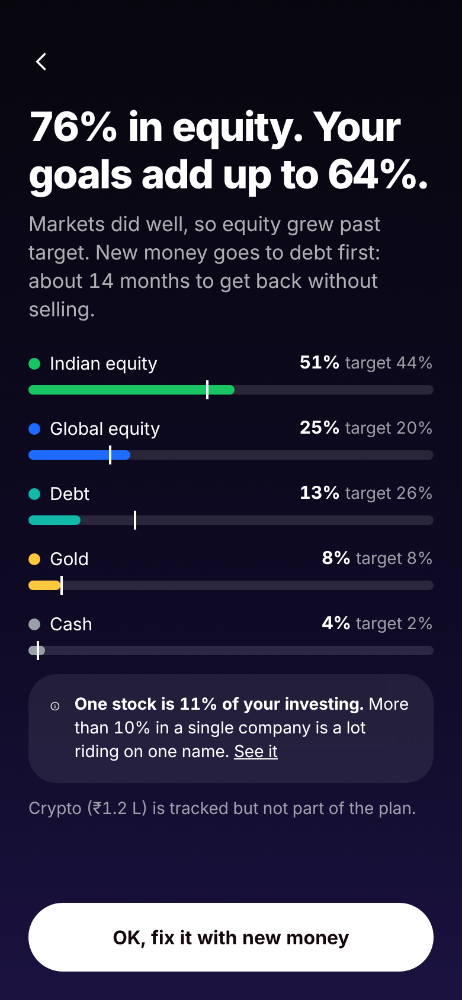

- **Id:** `V-5-2-MixCheck` · **Background:** `night`
- **Purpose:** Mix check: actual vs target by class, drift fix with new money, concentration nudge.
- **Goes to:** 5.1 Net Worth, 5.3 Holdings
- **Motion:** Paired bars animate actual vs target. The drift gap shades amber. The '14 months to fix' line animates a mini timeline. The concentration glass card slides up after 500ms.

**Copy:**

```text
76% in equity. Your goals add up to 64%.
Markets did well, so equity grew past target. New money goes to debt first: about 14 months to get back without selling.
Indian equity 51% target 44%
Global equity 25% target 20%
Debt 13% target 26%
Gold 8% target 8%
Cash 4% target 2%
One stock is 11% of your investing. More than 10% in a single company is a lot riding on one name. See it
Crypto (₹1.2 L) is tracked but not part of the plan.
OK, fix it with new money
```

### 5.3 Holdings

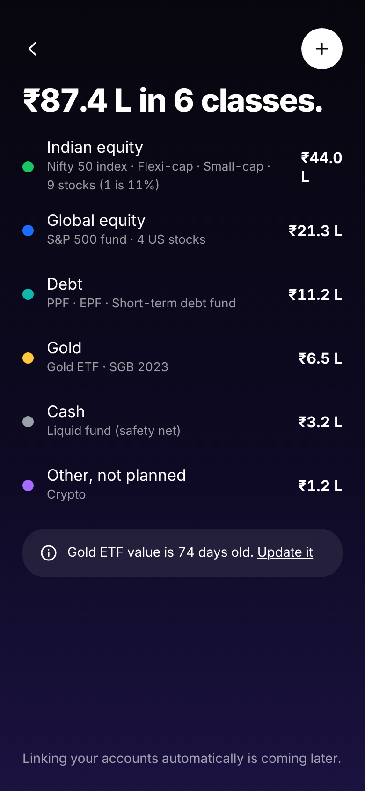

- **Id:** `V-5-3-Holdings` · **Background:** `night`
- **Purpose:** Holdings by class, any type, stale-value nudge.
- **Goes to:** 5.1 Net Worth, 5.6 Holding split
- **Motion:** Class rows expand and collapse with layout animation. The stale (74 days) chip wiggles once on enter.

**Copy:**

```text
₹87.4 L in 6 classes.
Indian equity Nifty 50 index · Flexi-cap · Small-cap · 9 stocks (1 is 11%) ₹44.0 L Global equity S&P 500 fund · 4 US stocks ₹21.3 L Debt PPF · EPF · Short-term debt fund ₹11.2 L Gold Gold ETF · SGB 2023 ₹6.5 L Cash Liquid fund (safety net) ₹3.2 L Other, not planned Crypto ₹1.2 L
Gold ETF value is 74 days old. Update it
Linking your accounts automatically is coming later.
```

### 5.4 Loans

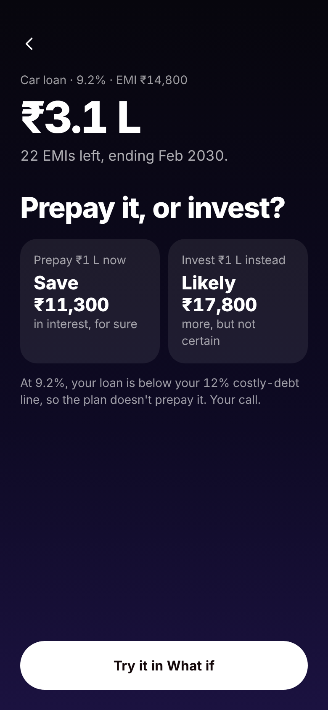

- **Id:** `V-5-4-Loans` · **Background:** `night`
- **Purpose:** Loans: prepay or invest comparison.
- **Goes to:** 5.1 Net Worth, 6.1 What If
- **Motion:** Two cards: 'for sure' is a solid bar and 'likely' is a fuzzy band, animating side by side so uncertainty is visible.

**Copy:**

```text
Car loan · 9.2% · EMI ₹14,800
₹3.1 L
22 EMIs left, ending Feb 2030.
Prepay it, or invest?
Prepay ₹1 L now
Save ₹11,300
in interest, for sure
Invest ₹1 L instead
Likely ₹17,800
more, but not certain
At 9.2%, your loan is below your 12% costly-debt line, so the plan doesn't prepay it. Your call.
Try it in What if
```

### 5.5 Timeline

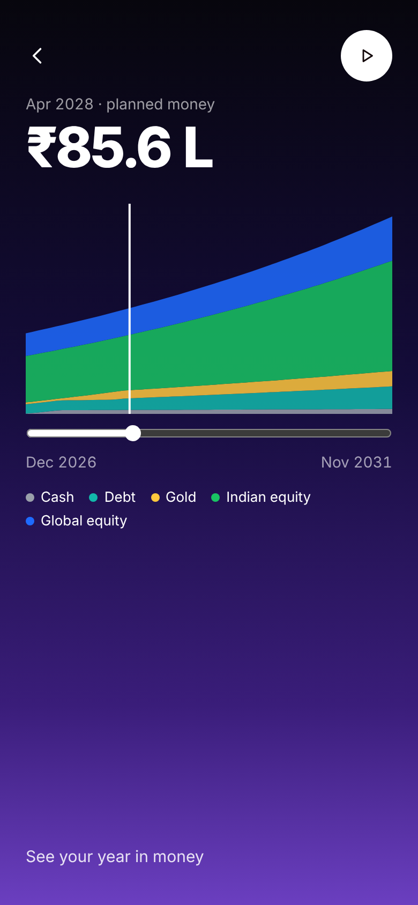

- **Id:** `V-5-5-Timeline` · **Background:** `violet`
- **Purpose:** Timeline: classes stacked over time, play and scrub.
- **Goes to:** 2.3 Milestone, 5.1 Net Worth
- **Motion:** A stacked area chart with a play button that animates months forward (about 4s for 5 years). The scrub lens snaps to months with haptic ticks. 'See your year in money' leads to a story-style recap.

**Copy:**

```text
Apr 2028 · planned money
₹85.6 L
Dec 2026 Nov 2031
Cash Debt Gold Indian equity Global equity
See your year in money
```

### 5.6 Holding split

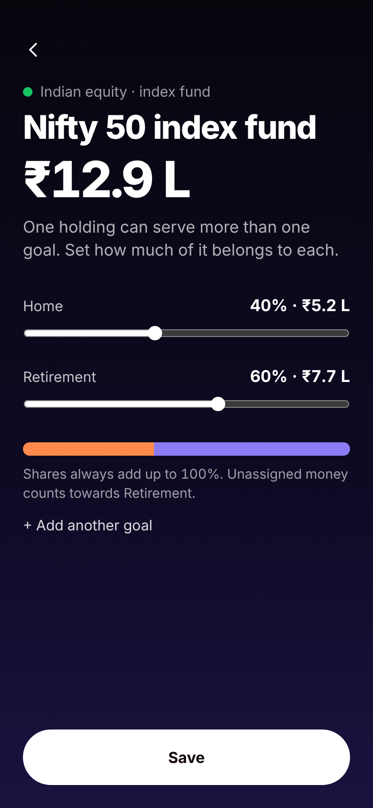

- **Id:** `V-5-6-HoldingSplit` · **Background:** `night`
- **Purpose:** Holding split: one holding serving several goals by %.
- **Goes to:** 5.3 Holdings
- **Motion:** A donut split with draggable handles. Shares always total 100%, so dragging one handle pushes the others. Values roll.

**Copy:**

```text
Indian equity · index fund
Nifty 50 index fund
₹12.9 L
One holding can serve more than one goal. Set how much of it belongs to each.
Home 40% · ₹5.2 L
Retirement 60% · ₹7.7 L
Shares always add up to 100%. Unassigned money counts towards Retirement.
+ Add another goal
Save
```

## 6 · What if (sandbox)

### 6.1 What If

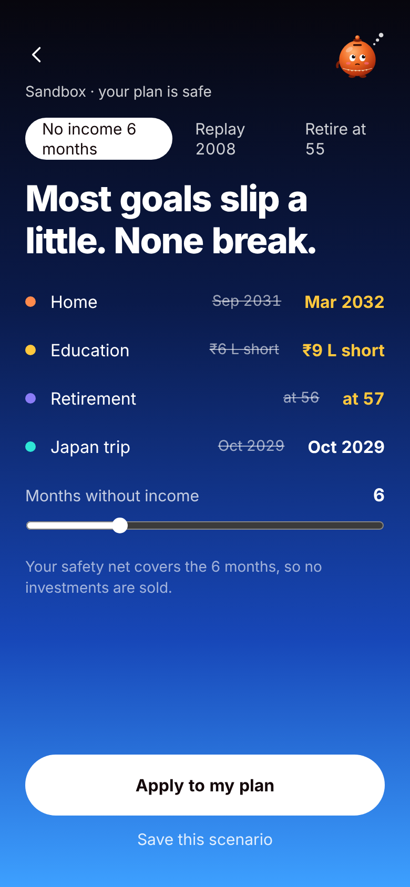

- **Id:** `V-6-1-WhatIf` · **Background:** `sky`
- **Purpose:** What if sandbox: scenario chips incl. Replay 2008, sliders, effect on every goal.
- **Goes to:** 2.1 Home, 6.2 Apply, 6.3 Scenarios
- **Motion:** Before/after per goal: old values strike through and new values slide in. Choosing a chip triggers a quick 'rewind' shimmer. Slider drags recompute under 16ms on the single-line path, then the ranges settle in about 300ms later.

**Copy:**

```text
Sandbox · your plan is safe
No income 6 months Replay 2008 Retire at 55
Most goals slip a little. None break.
Home Sep 2031 Mar 2032
Education ₹6 L short ₹9 L short
Retirement at 56 at 57
Japan trip Oct 2029 Oct 2029
Months without income 6
Your safety net covers the 6 months, so no investments are sold.
Apply to my plan
Save this scenario
```

### 6.2 Apply


- **Id:** `V-6-2-Apply` · **Background:** `sky`
- **Purpose:** Apply sheet: list of changes, plan vs new.
- **Goes to:** 2.1 Home, 6.1 What If
- **Motion:** Bottom sheet with spring. Applying makes the sheet collapse into a check, and Home's affected ring re-animates to its new value.

**Copy:**

```text
Apply 1 change?
Child's education Monthly amount ₹12,500 ₹16,000
Your monthly total goes from ₹55,000 to ₹58,500. Education moves to on track.
Apply
Keep exploring
```

### 6.3 Scenarios

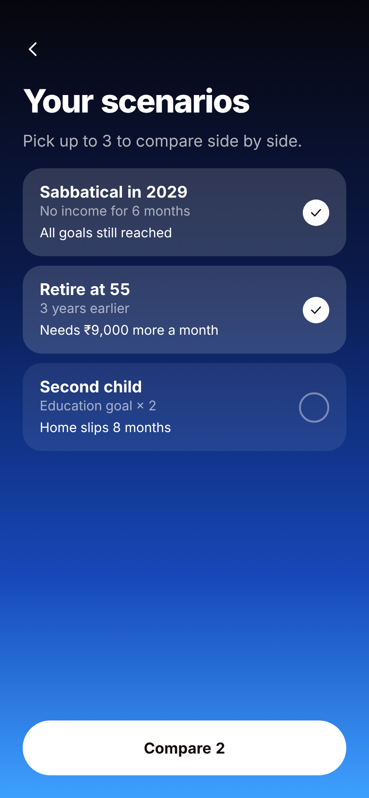

- **Id:** `V-6-3-Scenarios` · **Background:** `sky`
- **Purpose:** Saved scenarios, compare up to 3.
- **Goes to:** 6.1 What If
- **Motion:** Cards are selectable with a lift. 'Compare 2' morphs into a side-by-side table.

**Copy:**

```text
Your scenarios
Pick up to 3 to compare side by side.
Sabbatical in 2029 No income for 6 months All goals still reached Retire at 55 3 years earlier Needs ₹9,000 more a month Second child Education goal × 2 Home slips 8 months
Compare 2
```

## 7 · Retirement income (Sunita, 64)

### 7.1 Income Plan

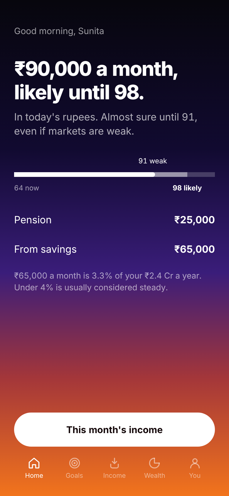

- **Id:** `V-7-1-IncomePlan` · **Background:** `dusk`
- **Purpose:** Retiree income plan (Sunita): monthly income, likely-until age.
- **Goes to:** 3.1 Goals, 7.2 Three Buckets, 7.3 This Month Income, 8.1 Profile Risk
- **Motion:** Calm motion only. The age numbers count. Pension and savings bars grow. No confetti for retirees, and Gullu is in his gentle pose.

**Copy:**

```text
Good morning, Sunita
₹90,000 a month, likely until 98.
In today's rupees. Almost sure until 91, even if markets are weak.
Pension ₹25,000
From savings ₹65,000
₹65,000 a month is 3.3% of your ₹2.4 Cr a year. Under 4% is usually considered steady.
This month's income
Home Goals Income Wealth You
```

### 7.2 Three Buckets

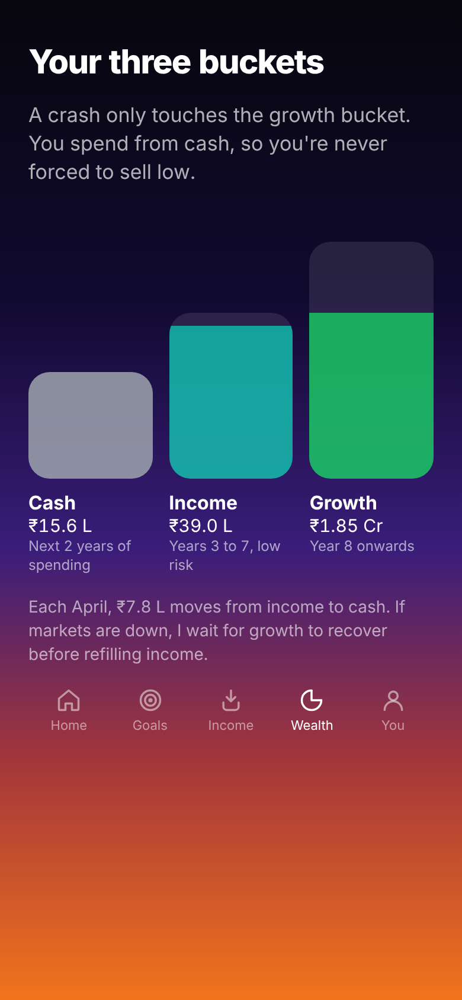

- **Id:** `V-7-2-ThreeBuckets` · **Background:** `dusk`
- **Purpose:** Three buckets: cash, income, growth with refill rule.
- **Goes to:** 3.1 Goals, 7.1 Income Plan, 7.3 This Month Income, 8.1 Profile Risk
- **Motion:** Liquid fill in three jars (Skia): the levels settle with a slow wave. The yearly refill shows as a flow from the income jar to the cash jar.

**Copy:**

```text
Your three buckets
A crash only touches the growth bucket. You spend from cash, so you're never forced to sell low.
Cash
₹15.6 L
Next 2 years of spending
Income
₹39.0 L
Years 3 to 7, low risk
Growth
₹1.85 Cr
Year 8 onwards
Each April, ₹7.8 L moves from income to cash. If markets are down, I wait for growth to recover before refilling income.
Home Goals Income Wealth You
```

### 7.3 This Month Income

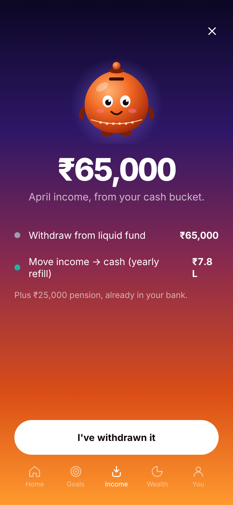

- **Id:** `V-7-3-ThisMonthIncome` · **Background:** `ember`
- **Purpose:** This month's income: what to withdraw and from where.
- **Goes to:** 3.1 Goals, 7.1 Income Plan, 7.2 Three Buckets, 8.1 Profile Risk
- **Motion:** The amount counts. The withdraw row has a 'pour' animation from the cash jar icon.

**Copy:**

```text
₹65,000
April income, from your cash bucket.
Withdraw from liquid fund ₹65,000
Move income → cash (yearly refill) ₹7.8 L
Plus ₹25,000 pension, already in your bank.
I've withdrawn it
Home Goals Income Wealth You
```

## 8 · You

### 8.1 Profile Risk

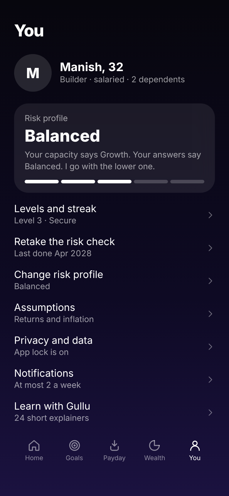

- **Id:** `V-8-1-ProfileRisk` · **Background:** `night`
- **Purpose:** You: profile, risk explained, rows for levels, retake, override, assumptions, privacy, notifications, learn.
- **Goes to:** 1.3 Risk Check, 10.1 Levels, 2.1 Home, 3.1 Goals, 4.2 Payday, 5.1 Net Worth, 8.2 Assumptions, 8.3 Privacy, 8.4 Learn, 8.5 Too aggressive warning, 9.3 Notification settings
- **Motion:** The profile meter animates to Balanced, with ghost markers for capacity and tolerance. Rows are press-highlighted.

**Copy:**

```text
You
M Manish, 32 Builder · salaried · 2 dependents
Risk profile
Balanced
Your capacity says Growth. Your answers say Balanced. I go with the lower one.
Levels and streak Level 3 · Secure
Retake the risk check Last done Apr 2028
Change risk profile Balanced
Assumptions Returns and inflation
Privacy and data App lock is on
Notifications At most 2 a week
Learn with Gullu 24 short explainers
Home Goals Payday Wealth You
```

### 8.2 Assumptions

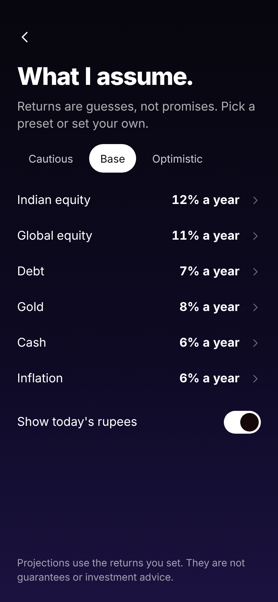

- **Id:** `V-8-2-Assumptions` · **Background:** `night`
- **Purpose:** Assumptions: return presets per class, inflation, today's rupees.
- **Goes to:** 8.1 Profile Risk
- **Motion:** Switching presets animates all values (rolling digits) together.

**Copy:**

```text
What I assume.
Returns are guesses, not promises. Pick a preset or set your own.
Cautious Base Optimistic
Indian equity 12% a year Global equity 11% a year Debt 7% a year Gold 8% a year Cash 6% a year Inflation 6% a year
Show today's rupees
Projections use the returns you set. They are not guarantees or investment advice.
```

### 8.3 Privacy

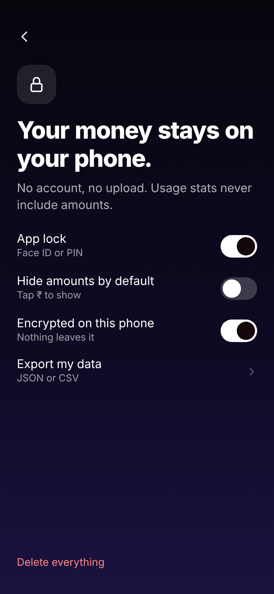

- **Id:** `V-8-3-Privacy` · **Background:** `night`
- **Purpose:** Privacy: app lock, hide amounts, encrypted, export, delete.
- **Goes to:** 8.1 Profile Risk
- **Motion:** A lock icon closes on the app-lock toggle. 'Delete everything' needs a hold-to-confirm ring (2s).

**Copy:**

```text
Your money stays on your phone.
No account, no upload. Usage stats never include amounts.
App lock Face ID or PIN
Hide amounts by default Tap ₹ to show
Encrypted on this phone Nothing leaves it
Export my data JSON or CSV
Delete everything
```

### 8.4 Learn

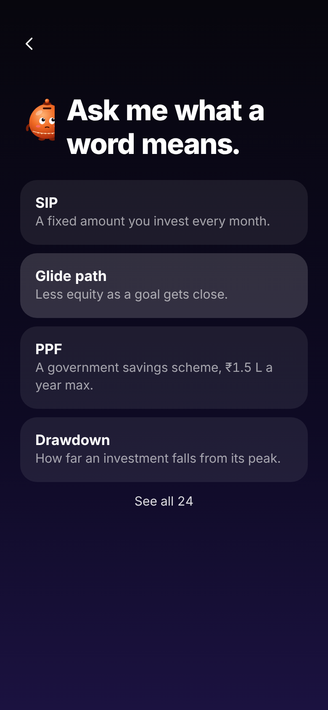

- **Id:** `V-8-4-Learn` · **Background:** `night`
- **Purpose:** Learn: Gullu's one-card explainers.
- **Goes to:** 8.1 Profile Risk
- **Motion:** Cards flip (3D rotateY) to reveal the explanation.

**Copy:**

```text
Ask me what a word means.
SIP A fixed amount you invest every month. Glide path Less equity as a goal gets close. PPF A government savings scheme, ₹1.5 L a year max. Drawdown How far an investment falls from its peak.
See all 24
```

### 8.5 Too aggressive warning

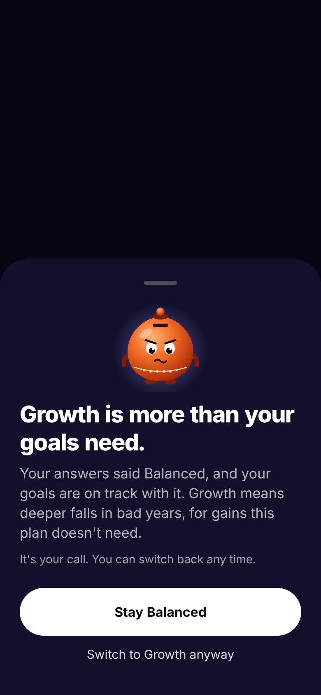

- **Id:** `V-8-5-RiskOverride` · **Background:** `night`
- **Purpose:** Too-aggressive warning when moving up a level.
- **Goes to:** 8.1 Profile Risk
- **Motion:** The sheet rises. Gullu shows concern. 'Stay Balanced' is the primary button.

**Copy:**

```text
Growth is more than your goals need.
Your answers said Balanced, and your goals are on track with it. Growth means deeper falls in bad years, for gains this plan doesn't need.
It's your call. You can switch back any time.
Stay Balanced
Switch to Growth anyway
```

## 9 · Notifications and widgets

### 9.1 Lock screen

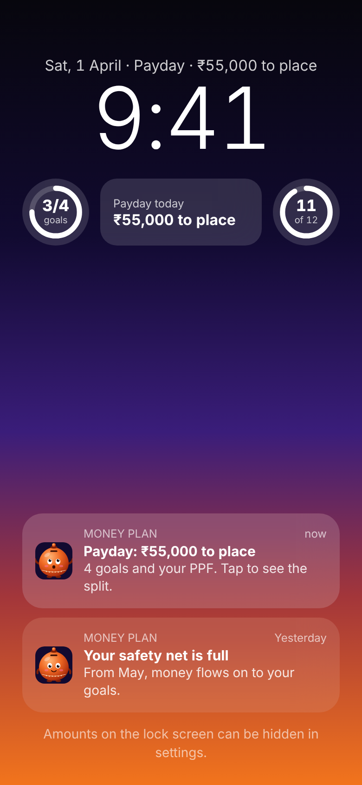

- **Id:** `V-9-1-LockScreen` · **Background:** `dusk`
- **Purpose:** Lock screen notification and lock-screen widgets (design reference).
- **Goes to:** —
- **Motion:** System UI. Not animated in-app.

**Copy:**

```text
Sat, 1 April · Payday · ₹55,000 to place
9:41
3/4 goals
Payday today ₹55,000 to place
11 of 12
MONEY PLAN now Payday: ₹55,000 to place 4 goals and your PPF. Tap to see the split.
MONEY PLAN Yesterday Your safety net is full From May, money flows on to your goals.
Amounts on the lock screen can be hidden in settings.
```

### 9.2 Expanded notification

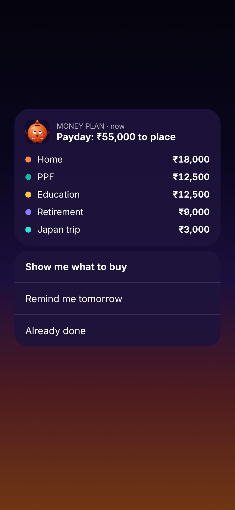

- **Id:** `V-9-2-NotificationExpanded` · **Background:** `dusk`
- **Purpose:** Expanded payday notification with the split and actions.
- **Goes to:** 4.4 Check In, 4.5 Receipt, 9.1 Lock screen
- **Motion:** System UI. Actions are notification categories.

**Copy:**

```text
MONEY PLAN · now Payday: ₹55,000 to place
Home₹18,000
PPF₹12,500
Education₹12,500
Retirement₹9,000
Japan trip₹3,000
Show me what to buy Remind me tomorrow Already done
```

### 9.3 Notification settings

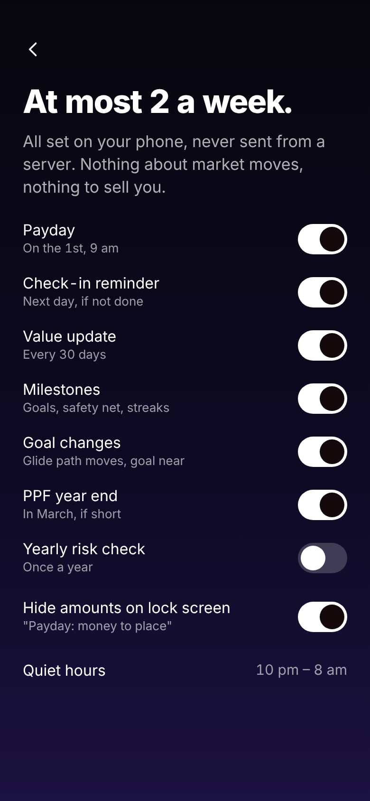

- **Id:** `V-9-3-NotificationSettings` · **Background:** `night`
- **Purpose:** Notification settings: 8 kinds, at most 2 a week, quiet hours.
- **Goes to:** 8.1 Profile Risk
- **Motion:** Toggles spring. The counter 'At most 2 a week' updates live.

**Copy:**

```text
At most 2 a week.
All set on your phone, never sent from a server. Nothing about market moves, nothing to sell you.
Payday On the 1st, 9 am
Check-in reminder Next day, if not done
Value update Every 30 days
Milestones Goals, safety net, streaks
Goal changes Glide path moves, goal near
PPF year end In March, if short
Yearly risk check Once a year
Hide amounts on lock screen "Payday: money to place"
Quiet hours 10 pm – 8 am
```

### 9.4 Home screen widgets

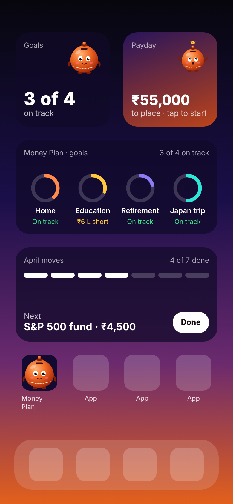

- **Id:** `V-9-4-HomeScreenWidgets` · **Background:** `custom`
- **Purpose:** Home screen widgets: small (status, payday, one goal), medium (goals, moves).
- **Goes to:** —
- **Motion:** Widgets are static, refreshed by the app after payday, check-in or value update.

**Copy:**

```text
Goals
3 of 4
on track
Payday
₹55,000
to place · tap to start
Money Plan · goals 3 of 4 on track
Home On track
Education ₹6 L short
Retirement On track
Japan trip On track
April moves 4 of 7 done
Next S&P 500 fund · ₹4,500 Done
Money Plan App App App
```

### 9.5 Notification system

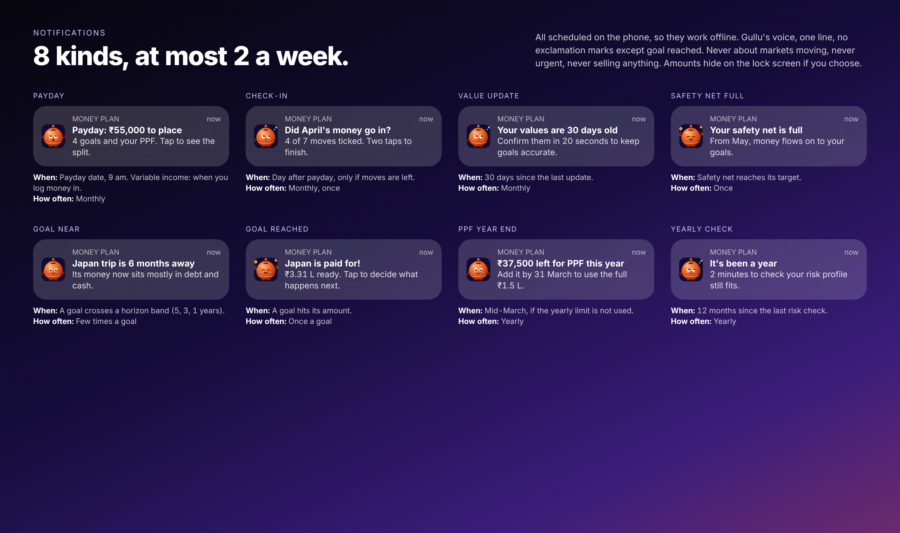

- **Id:** `V-9-5-NotificationSheet` · **Background:** `violet`
- **Purpose:** Notification system sheet: every kind, copy, timing, rules.
- **Goes to:** —
- **Motion:** Reference sheet.

**Copy:**

```text
NOTIFICATIONS
8 kinds, at most 2 a week.
All scheduled on the phone, so they work offline. Gullu's voice, one line, no exclamation marks except goal reached. Never about markets moving, never urgent, never selling anything. Amounts hide on the lock screen if you choose.
Payday
MONEY PLAN now Payday: ₹55,000 to place 4 goals and your PPF. Tap to see the split.
When: Payday date, 9 am. Variable income: when you log money in.How often: Monthly
Check-in
MONEY PLAN now Did April's money go in? 4 of 7 moves ticked. Two taps to finish.
When: Day after payday, only if moves are left.How often: Monthly, once
Value update
MONEY PLAN now Your values are 30 days old Confirm them in 20 seconds to keep goals accurate.
When: 30 days since the last update.How often: Monthly
Safety net full
MONEY PLAN now Your safety net is full From May, money flows on to your goals.
When: Safety net reaches its target.How often: Once
Goal near
MONEY PLAN now Japan trip is 6 months away Its money now sits mostly in debt and cash.
When: A goal crosses a horizon band (5, 3, 1 years).How often: Few times a goal
Goal reached
MONEY PLAN now Japan is paid for! ₹3.31 L ready. Tap to decide what happens next.
When: A goal hits its amount.How often: Once a goal
PPF year end
MONEY PLAN now ₹37,500 left for PPF this year Add it by 31 March to use the full ₹1.5 L.
When: Mid-March, if the yearly limit is not used.How often: Yearly
Yearly check
MONEY PLAN now It's been a year 2 minutes to check your risk profile still fits.
When: 12 months since the last risk check.How often: Yearly
```

### 9.6 Widget system

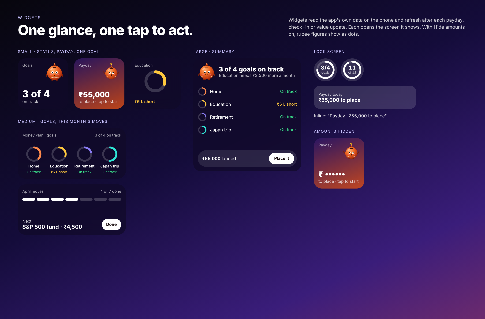

- **Id:** `V-9-6-WidgetSheet` · **Background:** `violet`
- **Purpose:** Widget system sheet: sizes, states, hide-amounts behaviour.
- **Goes to:** —
- **Motion:** Reference sheet.

**Copy:**

```text
WIDGETS
One glance, one tap to act.
Widgets read the app's own data on the phone and refresh after each payday, check-in or value update. Each opens the screen it shows. With Hide amounts on, rupee figures show as dots.
SMALL · STATUS, PAYDAY, ONE GOAL
Goals
3 of 4
on track
Payday
₹55,000
to place · tap to start
Education
₹6 L short
MEDIUM · GOALS, THIS MONTH'S MOVES
Money Plan · goals 3 of 4 on track
Home On track
Education ₹6 L short
Retirement On track
Japan trip On track
April moves 4 of 7 done
Next S&P 500 fund · ₹4,500 Done
LARGE · SUMMARY
3 of 4 goals on track Education needs ₹3,500 more a month
Home On track
Education ₹6 L short
Retirement On track
Japan trip On track
₹55,000 landed Place it
LOCK SCREEN
3/4 goals
11 of 12
Payday today ₹55,000 to place
Inline: "Payday · ₹55,000 to place"
AMOUNTS HIDDEN
Payday
₹ ••••••
to place · tap to start
```

## 10 · Habits — the engagement layer

### 10.1 Levels

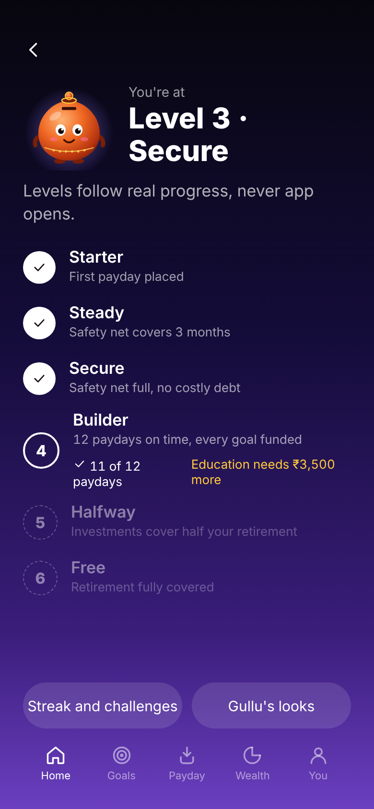

- **Id:** `V-10-1-Levels` · **Background:** `violet`
- **Purpose:** Levels: six levels tied to real progress, current and next with progress.
- **Goes to:** 10.3 Gullu collection, 10.4 Streak and challenges, 2.1 Home, 3.1 Goals, 4.2 Payday, 5.1 Net Worth, 8.1 Profile Risk
- **Motion:** The level ladder draws bottom-up. Completed checks pop in sequence. The current level glows. The next level's progress ring fills to 11/12.

**Copy:**

```text
You're at Level 3 · Secure
Levels follow real progress, never app opens.
Starter First payday placed
Steady Safety net covers 3 months
Secure Safety net full, no costly debt
4
Builder 12 paydays on time, every goal funded 11 of 12 paydays Education needs ₹3,500 more
5
Halfway Investments cover half your retirement
6
Free Retirement fully covered
Streak and challenges Gullu's looks
Home Goals Payday Wealth You
```

### 10.2 Level up

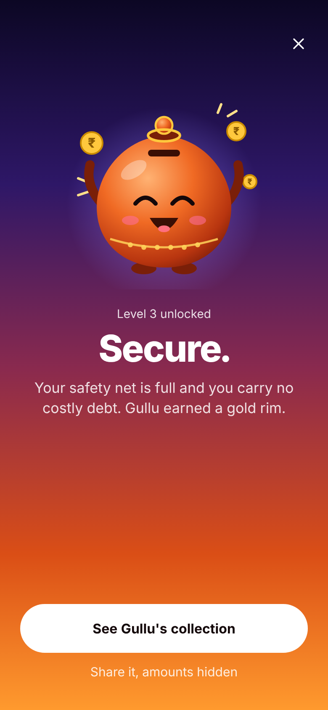

- **Id:** `V-10-2-LevelUp` · **Background:** `ember`
- **Purpose:** Level up: Secure. Gullu earned a gold rim.
- **Goes to:** 10.3 Gullu collection, 2.1 Home
- **Motion:** The biggest celebration in the app: the screen dims, Gullu spins once (Y-axis 360°, 900ms), and the gold rim draws on with a shine sweep. Coin and marigold particles, success haptic. Reduced motion: a cross-fade to the new skin.

**Copy:**

```text
Level 3 unlocked
Secure.
Your safety net is full and you carry no costly debt. Gullu earned a gold rim.
See Gullu's collection
Share it, amounts hidden
```

### 10.3 Gullu collection

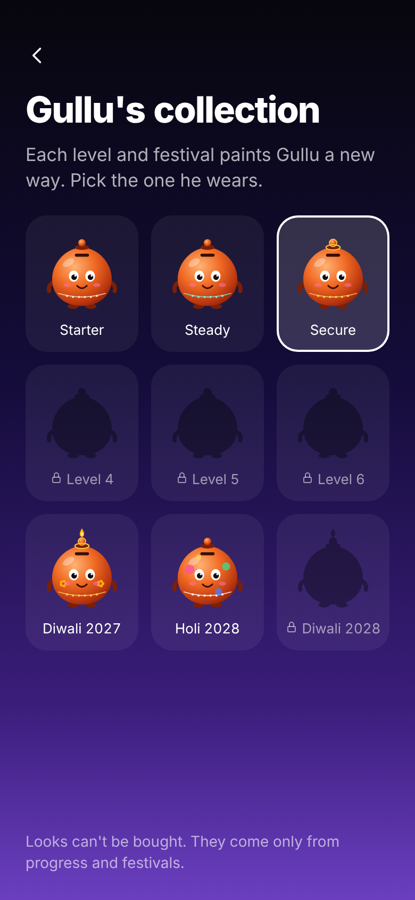

- **Id:** `V-10-3-Collection` · **Background:** `violet`
- **Purpose:** Gullu's collection: skins by level and festival; locked ones as silhouettes.
- **Goes to:** 10.1 Levels
- **Motion:** Grid stagger. Selecting a skin makes Gullu jump out of the tile into the header (shared element). Locked tiles shake gently when tapped, with an 'unlocks at Level 4' tooltip.

**Copy:**

```text
Gullu's collection
Each level and festival paints Gullu a new way. Pick the one he wears.
Starter
Steady
Secure
Level 4
Level 5
Level 6
Diwali 2027
Holi 2028
Diwali 2028
Looks can't be bought. They come only from progress and festivals.
```

### 10.4 Streak and challenges

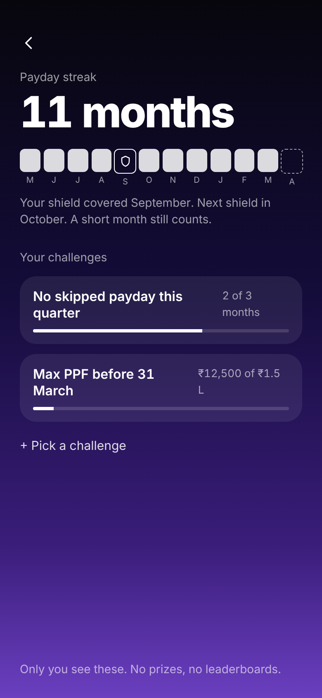

- **Id:** `V-10-4-Streak` · **Background:** `violet`
- **Purpose:** Payday streak with shield, plus your challenges.
- **Goes to:** 10.1 Levels, 10.5 Pick a challenge
- **Motion:** Month cells fill left to right. The shield cell shows a shield glint. Challenge progress bars fill.

**Copy:**

```text
Payday streak
11 months
M
J
J
A
S
O
N
D
J
F
M
A
Your shield covered September. Next shield in October. A short month still counts.
Your challenges
No skipped payday this quarter 2 of 3 months
Max PPF before 31 March ₹12,500 of ₹1.5 L
+ Pick a challenge
Only you see these. No prizes, no leaderboards.
```

### 10.5 Pick a challenge

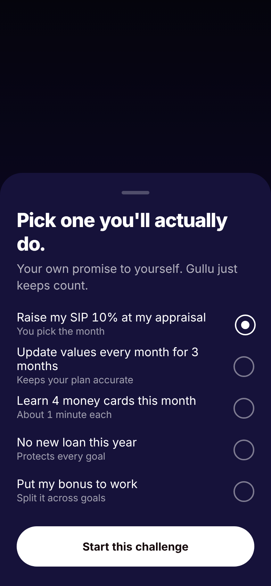

- **Id:** `V-10-5-PickChallenge` · **Background:** `violet`
- **Purpose:** Pick a challenge (self-set promises).
- **Goes to:** 10.4 Streak and challenges
- **Motion:** Option cards select with a lift. Start shows a quick stamp animation.

**Copy:**

```text
Pick one you'll actually do.
Your own promise to yourself. Gullu just keeps count.
Raise my SIP 10% at my appraisal You pick the month
Update values every month for 3 months Keeps your plan accurate
Learn 4 money cards this month About 1 minute each
No new loan this year Protects every goal
Put my bonus to work Split it across goals
Start this challenge
```

### 10.6 Money minute

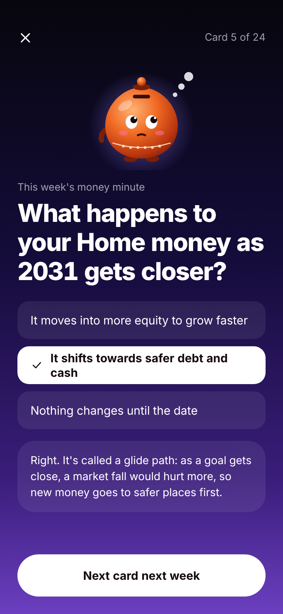

- **Id:** `V-10-6-MoneyMinute` · **Background:** `violet`
- **Purpose:** Weekly money minute: one question card.
- **Goes to:** 2.1 Home
- **Motion:** Answer reveal: the right answer turns green with a check-draw, the explanation expands, and Gullu nods. A wrong pick shakes softly, with no red flash and no penalty.

**Copy:**

```text
Card 5 of 24
This week's money minute
What happens to your Home money as 2031 gets closer?
It moves into more equity to grow faster
It shifts towards safer debt and cash
Nothing changes until the date
Right. It's called a glide path: as a goal gets close, a market fall would hurt more, so new money goes to safer places first.
Next card next week
```
